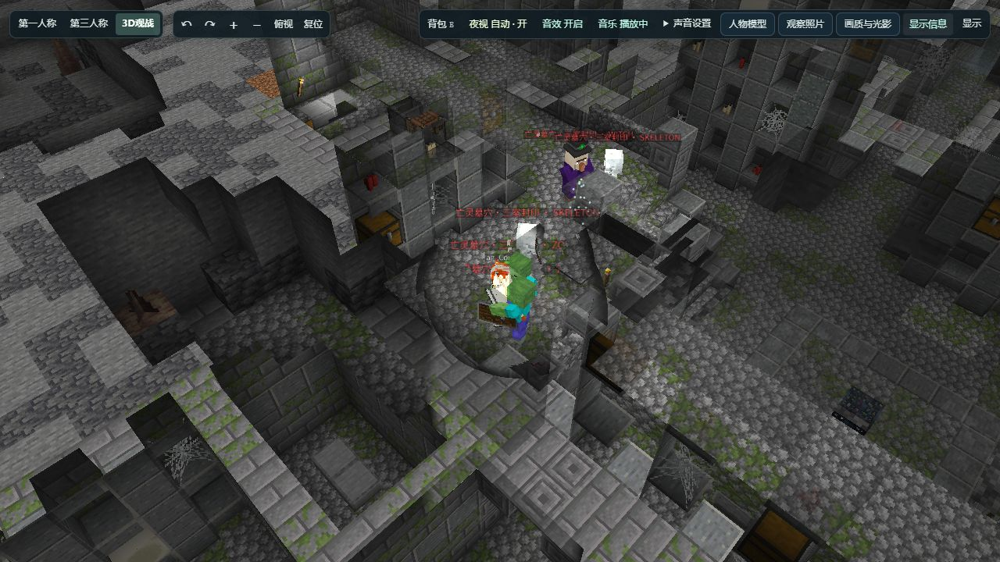
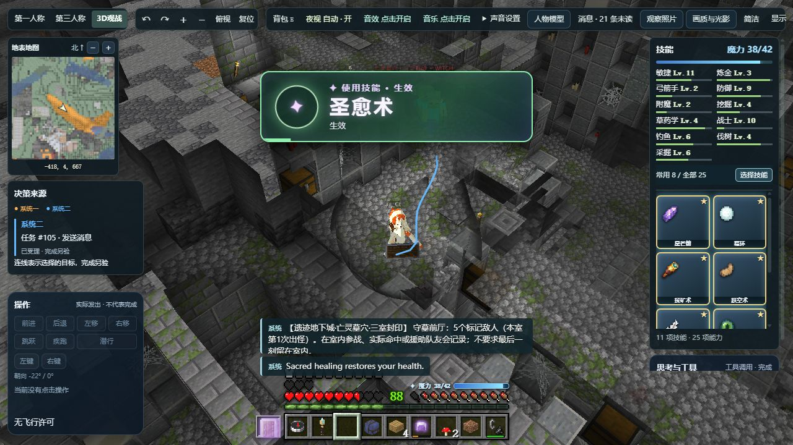
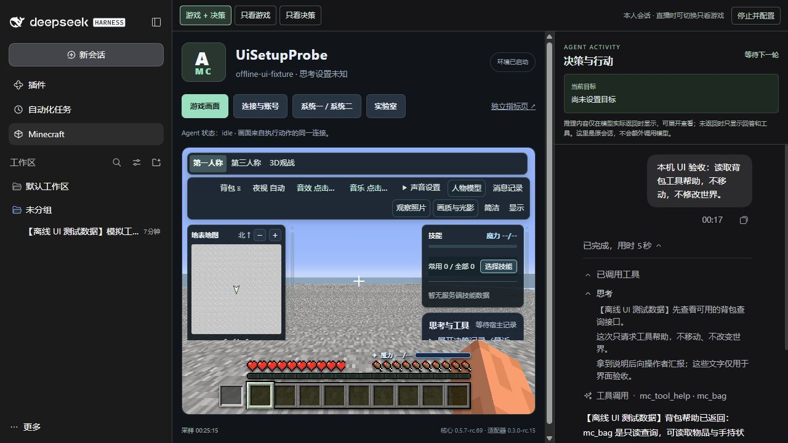

# DSH Minecraft Agent

**[0.3.0-rc.22](https://github.com/jcs130/dsh-minecraft-agent/releases/tag/v0.3.0-rc.22) 已发布到 [npm](https://www.npmjs.com/package/@jcs130/dsh-minecraft-agent)**，`latest` 指向 rc.22，精确依赖核心 **0.5.7-rc.89**。没有对应版本的预制材质时，自动显示兼容画面；缺失的新素材局部占位，普通用户无需手工准备资源。见[默认体验与验证](docs/viewer-compatible-20261025.md)。

两版未修改官方 DSH 0.2.1-rc.2 / rc.3 的默认 pnpm 公开 registry 安装、主进程／Worker、37 个 MCP 工具和真实本地知识库查询通过，见[npm 分发验收](docs/npm-publish-rc22.json)。匿名下载与原 GitHub 验收归档字节一致。

开发主干 **rc.23 候选**已跟进千灯纪扩展 **rc.24**，并完成核心 **rc.90 源码候选**的独立打包及 DSH / SDK / MCP 兼容验证。核心 rc.90 尚未公开到 npm，主干正式依赖仍锁定可安装的 rc.89；npm 插件仍为上述 rc.22。见[本次更新与验证边界](docs/registry-release.md)。

新增 [MineDojo 本地知识库配置与检查](docs/minedojo-knowledge.md)：Agent 通过核心 `mc_knowledge` 发现资料源、检索摘要并分页读取，结合当前状态和实际回执决策。先显式准备索引；CPU 词元向量属于词面检索，不冒充神经语义模型。语料、SQLite 和派生向量不随包分发。

包含[配置目标恢复与独立新会话](docs/goal-session-reset.md)、[生存攻略和步骤](docs/survival-decision.md)、[跨版本画面、原版玩家皮肤、公屏与特效开关](docs/viewer-resources-chat.md)。保留游戏旁的 DSH 原生推理／回答／工具会话、指标和实验室。

[角色、皮肤与服务器笔记](docs/character-notebook.md)可配置三个人格预设，矿透默认关闭；用户和 Agent 共用按服务器、账号与维度隔离的轻量笔记与离线检索。安装后复用 DSH 模型，从 Minecraft 侧栏填服务器和角色即可连接；协议默认 auto，普通服务器无需密码。安装本身不连接游戏或启动模型。

见[安装](README-INSTALL.md)和[发布记录](docs/registry-release.md)。npm 与 GitHub 保持原验收归档字节，包内 publication 是构建时快照；当前分发以主干文档及 Release 新增验收附件为准。

## 实时观战

同一个 Agent 的游戏连接可以展示第一人称、第三人称和 3D 观战画面，实时查看移动、战斗和环境变化。画面内可开关信息层、调整观察镜头；DSH 面板还可把游戏与原生推理、回答和工具记录并排展示。

上图和下图拍摄于 2026-10-26，来自本插件复用的 **Agent MC World 共享核心线上观战**，不是生成图片或 DSH 桌面窗口。这里展示了服务器自定义地下城；技能和角色外观取决于服务器包及外观资源，不代表所有原版服务器都有这些能力。

第三张是已留证的 DSH Web 集成测试截图：游戏与决策并排，右侧明确标注离线 UI 测试数据，用于展示布局，不冒充真实模型思考或桌面端实测。完整来源见[截图说明](docs/screenshots/README.md)。市场通过根目录 `screenshots.json` 按上述观战优先的顺序读取图片；[市场入口与审核状态](docs/marketplaces.md)单独记录。

## 核心归属

`agent-mc-world` 的唯一源码在 [minecraft-ai-friend/packages/agent-mc-world](https://github.com/jcs130/minecraft-ai-friend/tree/main/packages/agent-mc-world)。本插件直接依赖其版本化安装包；构建无需 Cortico World 源码。核心升级先用候选包通过宿主测试，再独立切换部署。

## 当前版本

**0.3.0-rc.22 npm / GitHub 发行版** 精确消费核心 **0.5.7-rc.89**；可选千灯纪包保持 0.5.0-rc.22。npm latest 与本仓库市场入口均为 rc.22。主维护 Minecraft Java 1.21.1，连接协议默认 auto，网页缺少精确材质时自动兼容。使用原始官方 DSH，不修改宿主文件或解析器。包发布、默认安装、Desktop 原生画面与实服游玩分别留证。

新增可选的 [Harness² 练习接入](docs/harness2.md)，复用 DSH 内置模型路由；默认关闭。显式配置后通过 mc_practice 比较原版、候选及留出场景，结果进入核心的方法库和现有游戏记忆，不自动采用或恢复线上 Agent。

没有 Cortico/N.E.K.O 依赖，不迁入其他角色的人格或记忆。安装本插件不会自动连接。旧 0.1.x 身体只保留在源码及迁移资料，不进入默认构建或发行包。

## 配置

- Node.js 24，在 DSH 中配置并选择默认模型。安装插件后，点击侧栏 **Minecraft**，填写服务器地址、角色名与登录方式，再点击 **保存并连接游戏**。首次任务可留空，先连接；之后在右侧原生会话里下达任务。无需另填模型密钥或手写 JSON。
- 协议默认 `auto`，交给 Mineflayer 识别服务器，也可显式指定 1.21.11 等受支持版本；正版首次连接需微软授权。已有登录服账号可在可选设置填 `/login` 密码，插件不自动注册账号。千灯纪邀请身份请沿用[专用接入流程](docs/qiandengji-invitation.md)，不能绕过激活直接建号。
- 首次配置保存在当前 DSH profile 的私有目录；同一服务器与身份续用自己的数据和会话，不同身份隔离。**停止并配置**先正常停止本插件的身体，保留目标、会话与记忆，然后允许修改。停止意图会持久化，重启不会擅自恢复。
- 高级部署仍可将 mc-harness 的 configFile 指向私有 JSON，显式设置 enabled、name、dataDir、personaFile、DSH provider/model、contextTokens/maxTokens、minecraft.host/port/username。该路径不受首次配置覆盖。
- `reasoningEffort` 显式传给 DSH 的创建与恢复入口；`off` 表示本轮关闭思考，其他等级以 provider 声明为准。未配置时沿用 DSH 的选择，不暗中降低模型质量。
- serverPack 默认 none；千灯纪选择 qiandengji。以当前服务端回执作为事实来源。
- 首次接入自动分配本机端口；高级配置使用 consolePort 和 minecraft.viewerPort。DSH 的 Minecraft 页面组合共享游戏面板和 **DSH 原生会话组件**，可切换游戏 + 决策、只看游戏、只看决策。实际推理默认折叠；模型未返回时不补写。侧栏输入直接进入该身体的原会话，不创建另一个 Agent；会话标签复用宿主已有输入框。/#experiments 可直达共享实验页，/metrics 仍可独立打开。
- 可用 startPaused 设置首次启动暂不连接；之后操作员的连接/断开选择保存在 dataDir/connection-state.json，重启沿用。暂停期间保留会话、目标和记忆，连接后才恢复目标及待投递的操作员指令。
- minecraft.hostDecisions.combat 显式设置 enabled、endpoint、model、mode、timeoutMs、minIntervalMs、maxAgeMs。快决策状态、候选与驱动来自共享核心，可选服务器包仅转出同一契约；默认关闭，不探测地址。模型不可用时保留核心的规则控制。
- 上下文预算：首次配置读取 DSH 所选模型的上下文元数据；不可用时回退 131072。高级配置可显式设 contextTokens。压缩在 `contextTokens × compaction.triggerRatio`（默认 0.55）时触发；旧的 `compaction.thresholdRatio` 若越过预算会在启动时报错。超预算请求先压缩再重试，仍超出则道别并下线。
- 省上下文：`*_script` 默认保留，用于按需发现共享工作/移动脚本和自己的方法库；可用 `tools.exclude` 显式关闭。默认 `tools.profile: "lean"` 隐藏少用工具（蓝图、铁路、摄影、战术等，可用 `tools.include` 单独加回或 `profile: "full"` 全开），工具说明压缩到 `tools.descriptionChars`（默认 300 字），参数细节用 `*_tool_help` 按需查；每步事件快照只保留最近 `context.events`（默认 10）条，回执给模型时截到 `context.receiptChars`（默认 1500 字），完整内容仍在会话日志。`node scripts/measure-context.mjs qiandengji 人设.md` 可测固定提示大小。
- 防打转：连续 6 次只走动/张望且停在约 24 格范围内（或没到新地方）时，给模型提示；到 12 次时当前目标自动完成（`progress.window/radius/closeAfter`）。每个目标最多 `maxGoalCalls`（默认 30）次模型调用。目标完成后，排队中的该目标回执直接丢弃，不再唤醒。退出道别结果写在 status.json 的 `goodbye`。
- 唤醒：默认把普通公屏、私聊、点名、危险和连接变化交给 Agent 判断是否回应；不要求每条聊天都回复。目标进行中另加本身任务回执。自发聊天、系统提示和状态倒计时不因此唤醒。配置面板或 `wake.publicChat:false` 可关闭普通公屏；`wake.on` 可覆盖类别。
- 目标：游戏内目标（`*_goal done`）结案会同时结束 DSH 会话目标；连续 `noopRoundLimit`（默认 3）轮没有游戏动作也会结束目标；`maxGoalRounds` 默认 40。
- 聊天：默认公屏，可写 `@玩家名`；`chat.maxPublicLines` 默认 0（不限制累计总句数），`chat.minIntervalMs` 默认 5000。用户仍可显式设置上限。私聊优先原版 `/tell`，结果未知不自动转公屏。配置 `chat.goodbye` 时保留下线道别及 `status.json` 回执。
- API key 由 DSH provider 环境变量提供，游戏密码按服务器及用户名独立配置；不要写入人格、聊天或仓库。

官方 DeepSeek 云端的显式无思考配置见 [provider 示例](examples/harness/deepseek.patch.yml) 和 [Agent 示例](examples/harness/agent.json)。示例安装时不启用，须先填自己的路径、账号与预算。完整说明见 [迁移指南](docs/harness-migration.md)，旧版说明见 [0.1.x 文档](docs/legacy-0.1.md)。

## 开发

精确依赖已公开，开发使用 `npm ci`、`npm run build`、`npm test`。锁文件保留 registry SemVer 地址与归档完整性，不引入 Git/URL 子依赖。构建生成薄适配器及 DSH 浏览器入口；通用页面、渲染和控制由核心消费的 mc-visual-console 提供。回归包括真实 DSH Session API、模型请求与取消、回合、动作归因、会话面板绑定、暂停持久化、原始官方 DSH 主进程/Worker 加载，以及旧版修复工具的回滚。`MC_DSH_PROFILE` 可将 stock fixture 指向隔离的真实安装 profile，`DSH_RUNTIME` 用于其他宿主 API 测试的外置安装。

主模型工具动作携带真实 session/turn/step 的 `system2` 归因；不把规则动作或影子建议冒充学习策略采用。状态文件显示实际安装的核心和适配器版本、请求的思考等级；流耗时与首字延迟不等于引擎执行耗时。

MIT。data/transmigrators 中鸣人、桐人是第三方虚构角色的演示人格；不附带第三方 YSM 模型。
