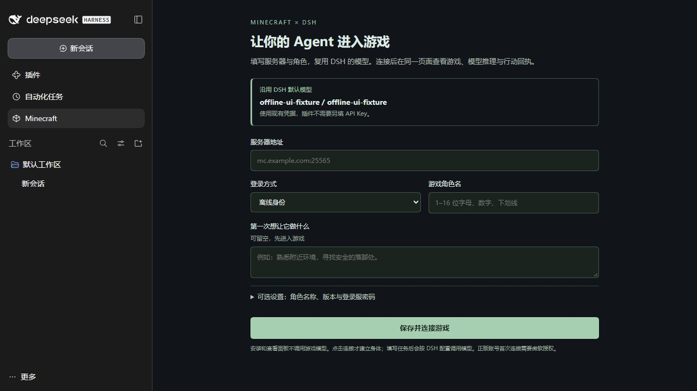

# 首次接入与决策面板（rc.15）

安装插件后，在 DSH 内完成少量配置即可进服，不要求用户写 Agent JSON。[rc.15 GitHub Release](https://github.com/jcs130/dsh-minecraft-agent/releases/tag/v0.3.0-rc.15) 已公开并通过匿名下载及默认安装验证；npm rc.15 也已公开，默认 registry 安装与运行验证通过，直接使用[安装指南](../README-INSTALL.md)中的固定 npm 版本。不同分发渠道与真实服务器验收分别记录。

## 在 DSH 里连接

1. 使用 Node.js 24 和 DSH，在宿主里配置凭据并选好默认模型。插件复用该模型、凭据和所选思考等级。
2. 安装 rc.15 插件，打开侧栏 **Minecraft**。
3. 填服务器地址（如 `mc.example.com:25565`）、登录方式和角色名。默认 `auto`，由 Mineflayer 识别服务器协议；可在可选设置显式填写 `1.21.11` 等受支持的实际版本。已保存的显式版本不会被自动改写。
4. 点击 **保存并连接游戏**。已有登录服账号需要 `/login` 密码时，在可选设置填写；这里只登录已有账号，不注册账号。正版首次连接仍需完成微软授权。
5. 等待核心的连接、认证和世界状态就绪，再通过右侧原生 DSH 输入框下达任务。首次任务可以留空，这时只建立游戏连接，不开始游戏推理。

模型未配置、地址不合法、启动失败与未知状态都会显示错误；不会自动重复提交配置。页面加载、刷新、布局切换和读取状态不发起游戏推理。

连接使用核心的 Mineflayer 身体和同一连接的内置 viewer，无需另外启动 Java 客户端。DSH 面板只保留 Agent 账号与网页画面，不提供缺少安装配置的观察者/玩家原生客户端启动按钮。游戏就绪、画面准备和画面失败分别显示；画面匹配实际协商版本，缺少资源会明确提示。

普通聊天默认发送公屏文本，点名交流也可直接在公屏进行。不假定服务器开放 `/msg` 私聊；只有明确要求私聊且已确认支持时才使用对应命令，不用私聊规避公屏限额。

千灯纪等邀请制服务器必须先完成其[邀请接入流程](qiandengji-invitation.md)。沿用已有身份文件，仅在 `gameAccountCreated=true` 且 `state=ready` 时连接。通用首次配置不代替服务器激活，也不自动开启专用规则或重复建号。专用服务器包、高级人格和已有部署仍使用 `configFile`；填写该路径时不会创建第二套首次配置身体。

## 看见模型做了什么

截图使用本机协议测试世界与确定性的离线 UI provider；画面中的推理和用量是明确标注的测试数据，不能当作真实模型性能。

- **游戏 + 决策**：共享游戏面板在左，DSH 原生会话在右；窄窗口上下排列。
- **只看游戏**：隐藏原生会话，便于直播。游戏内聊天等世界内容仍属于游戏画面。
- **只看决策**：使用完整宽度阅读原会话。模型返回的推理、工具调用、输入和结果由 DSH 原生组件渲染，可展开查看。

只显示模型实际返回的推理。关闭思考或 provider 未返回推理时，仅显示回答与工具，不补写“思考过程”。工具执行完成也不自动等于用户目标完成。当前目标使用该会话的 goal 投影，缺失时显示未提供。

侧栏页面保留并订阅该 Minecraft Agent 的已有 session，不切换当前选中的其他会话，也不创建新的 Agent。右侧输入会进入这个原会话。原会话里的 Minecraft 标签保留完整游戏面板和 DSH 外层输入框；要阅读推理可切换原生“对话”标签，要并排观看可使用侧栏 Minecraft。DSH 不允许递归嵌入同一个 conversation.content，因此会话标签不再套一层会话。

此视图沿用 DSH 本来的会话与持久化机制。插件没有为观战另存推理副本，也没有把推理正文写入运行指标或实验室白名单；直播前可切换只看游戏。

## 保存、停止和恢复

首次配置位于当前 DSH profile 的 `minecraft-agent/quick-setup.json`。每个服务器、认证方式和账号使用独立的 `agents/<scope>/` 数据目录，保留自己的 `session-id.txt`、目标和游戏记忆。端口自动分配到本机回环地址。

服务器密码单独保存在当前账号目录的私有文件，页面只返回“已保存”，不回显密码。模型凭据继续由 DSH provider 管理。不要把这些私有目录提交到仓库。

点击 **停止并配置**会先停止本插件拥有的身体，保留原数据，再显示配置表单。同一身份续用原会话；不同身份隔离。显式停止状态持久化，重启 DSH 不会恢复这个已停止的身体。重新点击保存并连接才重新连接；它不会修改其他宿主或 Agent。

### 目标和新会话（rc.20）

配置页的 **配置目标** 对应 `config.goal`。仅在连接／重载时，原目标已完成、受阻或暂停且与配置目标不同时，会在同一会话里建立并激活新目标，保留原记录，不改 `sessionKey`。例如“和玩家互动”已完成，配置为“自主生存”，后者不再被旧目标挡住。`active` 目标不会被配置自动替换；相同文案的已完成、受阻或暂停目标也不会因重连重复创建或绕过原状态。暂停／受阻的不同旧目标先通过官方 DSH `goals.clear` 留下清除记录，再创建新目标。

需要放弃当前会话目标，或重做已完成的同一目标时，先停止，再到 **连接** 页点击 **重置会话并保存配置**；也可独立勾选 **新建会话** 后保存或连接，不需要更换 DSH 能力预设。仅保存不会连接或调用模型。此操作切换到独立会话目录，保留账号、密码、皮肤、人格、服务器笔记和旧会话，不要求手动删除 `session-id.txt`。连接后采用当前填写的配置目标；留空就只连接。更换已使用的能力预设仍须新建会话，并清空旧任务，避免在另一套工具下重放。

正常保存、重连和进程恢复继续使用原会话。新会话不是绕过轮次或失败保护的自动重试；长期任务仍受显式预算和真实执行结果约束。具体修复与隔离验证见[目标与会话修复](goal-session-reset.md)。

### 用攻略与步骤辅助决策

核心已内置按需检索的 `mc_knowledge`：Java 1.21.1 的床与睡眠、夜间庇护、装备、据点、储物、种植、食物和烹饪资料，以及对应物品、方块和配方索引。默认精简工具集保留该入口，`mc_script` 提供步骤脚本与方法发现，`mc_memory` 提供本服务器历史经验与笔记。Agent 的稳定提示已补充“现场状态 → 相关资料与经验 → 小阶段行动 → 回执验证 → 保存有用经验”的选择方法，不强制按固定攻略顺序游玩。

查资料在本地完成，无需额外模型、网络或向量服务。攻略适用版本、配方和当前材料仍须核对，工具存在不代表动作已成功。MineDojo 历史 Wiki 的离线研究样本与这套随包生存资料是不同来源，当前不能把它说成已内置的完整 MineDojo 知识库。见[生存资料入口](survival-decision.md)。

高级 `configFile` 部署保留原先的生命周期和端口设置。更换现役依赖应先正常停止对应 Agent，源码提交不代表已获准中断其他正在运行的服务。

## 验证边界

候选通过官方 DSH Web 的默认插件安装、原生会话渲染和独立本机 Java 1.21.1 协议测试世界验证。UI 推理由确定性本机测试 provider 返回，只检验显示、工具回执和会话绑定，不代表真实模型的游戏能力。没有调用付费模型或接入现役账号。

Desktop 消费同一客户端构建与自描述契约；桌面原生窗口及微软首次授权交互仍需在对应环境验收，不能用 Web 截图代替。源码、安装包与实际验证信息见当前候选记录。
